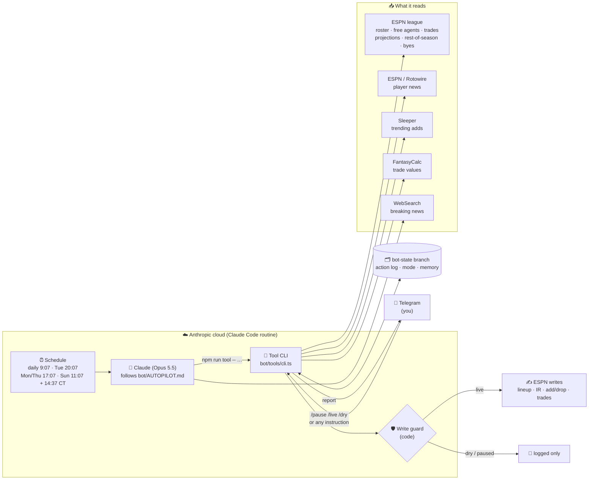
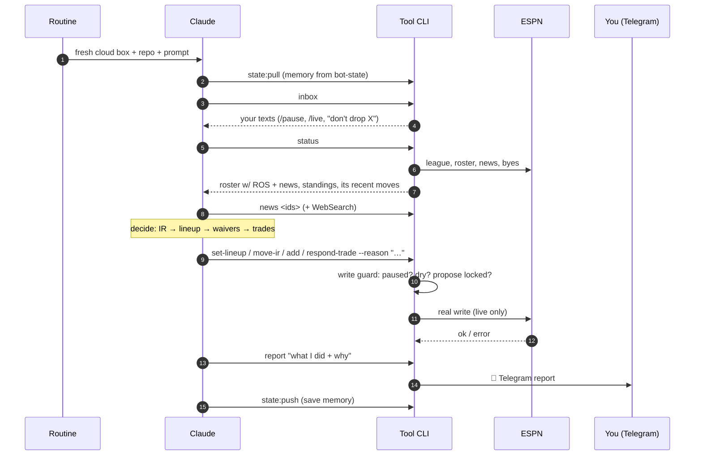
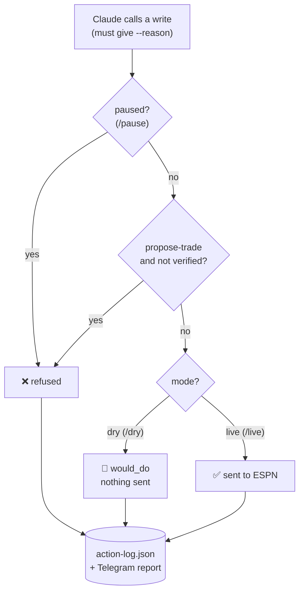
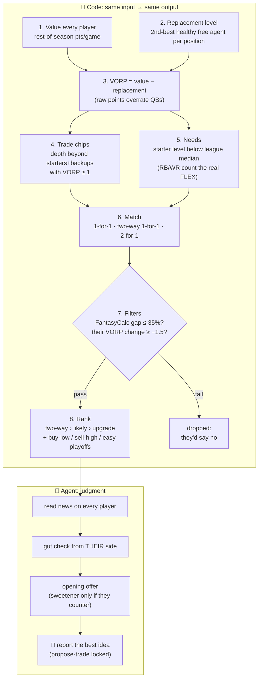

# FantasyBot

Autopilot for an ESPN fantasy football league. A **Claude Code scheduled
routine** runs on a schedule, reads the league, and manages the team itself:
lineup, IR, free agents, waivers, trades. Then it reports what it did on
Telegram.

> ⚠️ Uses ESPN's **unofficial** fantasy API with your own login cookies. It isn't affiliated with or endorsed by ESPN, and may break or conflict with ESPN's terms. Use at your own risk. Start in `dry` mode.

## How it works

### The big picture



### One run, step by step



### The safety switches



These checks live **in code** (`guardedWrite` in `bot/tools/cli.ts`), not in the prompt, so Claude can't talk its way past them.

### How trade ideas work

Trades are split between **code** (deterministic math, `bot/decisions/tradeFinder.ts`) and **the agent** (judgment, `bot/AUTOPILOT.md`). The rules come from published fantasy trade strategy (PFF, FantasyPros, Footballguys, Fantasy Footballers).



**Why VORP matters (real example, week 9):**

| Player | ROS pts/game | Free-agent replacement | VORP |
|---|---|---|---|
| Patrick Mahomes (your 3rd QB) | 17.4 | 15.0 (QB) | **+2.4** |
| Tony Pollard (target) | 15.4 | 8.6 (RB) | **+6.8** |
| Josh Jacobs (target) | 17.6 | 8.6 (RB) | **+9.0** |

On raw points Mahomes ≈ Jacobs. On VORP he's worth about a quarter of him, because a 15/g QB is free on waivers. So the finder returns **no idea** rather than an offer nobody would accept. The playbook then treats a low-VORP extra QB as a wasted roster spot to drop for a needed waiver add.

**Signals on every player line:**

```
PO x1.21 easy   -> weeks 15-17 opponents allow 21% more fantasy pts than average (ESPN defense-vs-position)
PO x0.77 hard   -> 23% fewer
BUY-LOW?        -> scoring well below his rest-of-season projection: likely to bounce back
SELL-HIGH?      -> scoring well above it: likely to cool off
```

### What the agent sees each run

| Source | What it gives | Command |
|---|---|---|
| ESPN league | roster, slots, injury tag, % owned, locked?, record, opponent, standings, waiver rules, trade deadline | `status` |
| ESPN stats | this-week projection, **rest-of-season pts/game**, season average | `status`, `free-agents` |
| ESPN / Rotowire | **player news**: injuries, coach quotes, timelines | `news <ids>` (+ inline headline) |
| ESPN schedule | bye weeks | `status` (`upcomingByes`) |
| ESPN opponent ratings ("OPRK") | fantasy-playoff schedule strength per player, weeks 15–17 (`PO x1.12 easy`) | `status`, `free-agents`, `trade-ideas` |
| Derived | buy-low / sell-high flag (actual vs ROS), VORP vs the 2nd-best free agent | `status`, `trade-ideas` |
| Its own log | its moves from the last 7 days (no flip-flopping) | `status` (`recentActions`) |
| Sleeper | trending adds (24h) | `free-agents` |
| FantasyCalc | trade values / fairness | `trades`, `trade-ideas` |
| WebSearch | breaking news, game-day inactives | Claude's own tool |
| You | `/pause` `/resume` `/dry` `/live` + free-text instructions | `inbox` |

### Key pieces

- **Brain**: Claude, following `bot/AUTOPILOT.md`. The old projection and
  optimizer code is still there as tools Claude can call.
- **Memory**: `bot/state/*.json` lives on the `bot-state` branch
  (`npm run state:pull` / `state:push`). Runs never commit to `master`.
- **Audit trail**: every write attempt (dry or live) and Claude's reason
  goes in `bot/state/action-log.json`.
- **Secrets**: environment variables on the routine's cloud environment.
  Claude can read them. That's an accepted tradeoff (no true vault there).
- `bot/run.ts` (the old tap-to-approve bot) still works as a manual fallback,
  but nothing schedules it anymore.

## Local setup (for testing)

1. `npm install`
2. Copy `bot/config.example.json` to `bot/config.json` and fill in your
   ESPN cookies, team info, and Telegram bot token/chat id.
   **`bot/config.json` is gitignored — local-only, never committed.**
3. `npm run espn:test` — confirms cookie auth works, prints your roster (or
   lists all teams if `teamId` isn't set yet, so you can find yours).
4. `npm run telegram:test` — sends a test message with a button; tap it, run
   again to confirm the bot sees the tap.
5. `DRY_RUN=1 npm run bot:run` — one full pass, logs intended actions instead
   of touching ESPN/Telegram live.
6. Once verified: `npm run bot:run` for a real local run.

## Production setup (Claude routine)

1. Cloud environment env vars (same names `bot/state/store.ts` reads):
   `ESPN_LEAGUE_ID ESPN_SEASON_YEAR ESPN_SWID ESPN_S2 ESPN_TEAM_ID
   ESPN_TEAM_NAME TELEGRAM_BOT_TOKEN TELEGRAM_CHAT_ID`.
2. Network access: **Custom**, allowing `lm-api-reads.fantasy.espn.com`,
   `lm-api-writes.fantasy.espn.com`, `site.api.espn.com` (player news), `api.telegram.org`, `api.sleeper.app`,
   `api.fantasycalc.com`, `*.fantasypros.com`, plus the default package hosts.
3. Routine prompt: run `npm ci` and `npm run state:pull`, follow
   `bot/AUTOPILOT.md`, finish with `npm run state:push`. Never edit code.
4. Schedule (`CRON_TZ=America/Chicago`): daily 09:07, Tue 20:07,
   Thu 17:07, Sun 11:07 + 14:37, Mon 17:07.
5. Start in `dry` mode. After a week of good reports, text the bot `/live`.

## Status

- Reads, the write guard, dry mode, and waiver claims are tested against the real league.
- `setLineup` is verified live. `move-ir` (slot 21), `add` for instant free
  agents (`FREEAGENT` txn) and `respond-trade` still say NEEDS LIVE
  VERIFICATION in `bot/espn/client.ts`.
- `propose-trade` is locked until the supervised live test.
